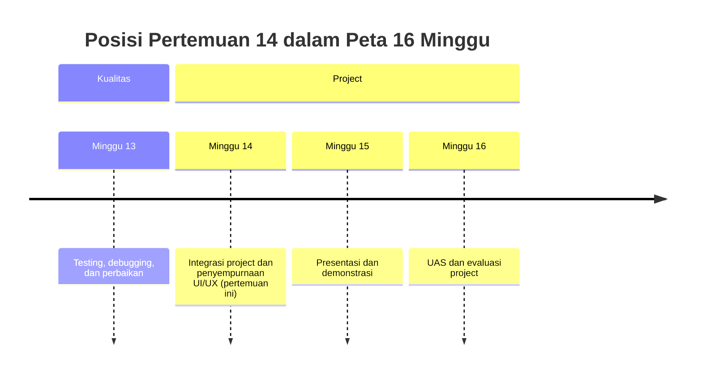
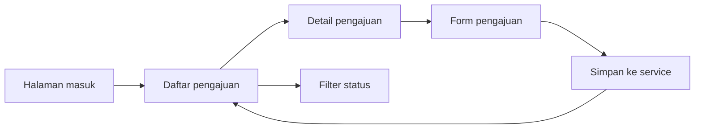

# Pertemuan 14 — Integrasi Project dan Penyempurnaan UI/UX

| | |
|:--|:--|
| **Minggu** | 14 |
| **Tanggal** | Rabu, 16 Desember 2026 (SI-VIIB) / Sabtu, 19 Desember 2026 (SI-VIIA) |
| **CPMK** | CPMK-5 |
| **Model Pembelajaran** | Project Based Learning / Praktikum |
| **Stack** | Flutter + Dart, `LayoutBuilder`, `MediaQuery`, `ThemeData`, `flutter analyze` |
| **Milestone** | M8 — Candidate Release |

> **Catatan penting:** Pertemuan 14 menggabungkan fitur yang sudah dibuat pada pertemuan sebelumnya menjadi satu alur aplikasi, lalu menyempurnakan tampilan dan pengalaman pengguna. Hasil pertemuan ini adalah **candidate release**, yaitu versi kandidat yang sudah dapat diuji oleh pihak lain.
>
> **Batas cakupan:** Materi berfokus pada integrasi alur, konsistensi data dan tampilan, tata letak responsif, aksesibilitas dasar, serta pencatatan versi rilis. Publikasi ke Play Store atau App Store, pengujian beban, dan otomatisasi rilis belum termasuk pada pertemuan ini.

---

## Daftar Isi

- [Pertemuan 14 — Integrasi Project dan Penyempurnaan UI/UX](#pertemuan-14--integrasi-project-dan-penyempurnaan-uiux)
  - [Daftar Isi](#daftar-isi)
  - [1. Keterkaitan Pertemuan dengan RPS OBE](#1-keterkaitan-pertemuan-dengan-rps-obe)
  - [2. Capaian Pembelajaran Pertemuan](#2-capaian-pembelajaran-pertemuan)
  - [3. Pemantik Kasus: Fitur Terpisah Belum Menjadi Aplikasi](#3-pemantik-kasus-fitur-terpisah-belum-menjadi-aplikasi)
  - [4. Integrasi Fitur Menjadi Satu Alur](#4-integrasi-fitur-menjadi-satu-alur)
  - [5. Konsistensi Tampilan dan Pengalaman Pengguna](#5-konsistensi-tampilan-dan-pengalaman-pengguna)
  - [6. Tata Letak Responsif dengan LayoutBuilder](#6-tata-letak-responsif-dengan-layoutbuilder)
  - [7. Aksesibilitas Dasar pada Aplikasi Mobile](#7-aksesibilitas-dasar-pada-aplikasi-mobile)
  - [8. Menyiapkan Candidate Release](#8-menyiapkan-candidate-release)
  - [9. Case Based Learning: Integrasi Pengajuan Ruang](#9-case-based-learning-integrasi-pengajuan-ruang)
  - [10. Aktivitas Kelompok](#10-aktivitas-kelompok)
  - [11. Latihan Individu](#11-latihan-individu)
  - [12. Pemanfaatan AI sebagai Coding Assistant](#12-pemanfaatan-ai-sebagai-coding-assistant)
  - [13. Kuis Formatif](#13-kuis-formatif)
  - [14. Keluaran Pembelajaran — Tugas 14](#14-keluaran-pembelajaran--tugas-14)
  - [15. Rubrik Tugas 14](#15-rubrik-tugas-14)
  - [16. Verifikasi Kode](#16-verifikasi-kode)
  - [17. Persiapan ke Pertemuan 15](#17-persiapan-ke-pertemuan-15)
  - [Referensi Terkait](#referensi-terkait)
  - [Lampiran: Kode Praktikum](#lampiran-kode-praktikum)

---

## 1. Keterkaitan Pertemuan dengan RPS OBE

Pertemuan 14 mendukung **CPMK-5**:

> Mahasiswa mampu menghasilkan, mendemonstrasikan, dan mendokumentasikan solusi mobile untuk kebutuhan Sistem Informasi.

Pada RPS, pertemuan ini dikaitkan dengan **Sub-CPMK-4.3** tentang mempersiapkan release candidate dan **Sub-CPMK-5.1** tentang mengintegrasikan fitur menjadi solusi mobile Sistem Informasi. CPMK-5 memiliki bobot 25% yang tersebar pada pertemuan 14–16, dengan Pertemuan 14 sebagai tahap penyiapan produk.

Fokus pertemuan ini adalah:

1. menggabungkan fitur menjadi satu alur yang dapat dijalankan dari awal sampai akhir;
2. menyamakan model data, status, dan pesan antarbagian aplikasi;
3. menyempurnakan tampilan, tata letak, dan umpan balik;
4. menghasilkan build candidate release beserta catatan versi.



Pertemuan 13 menghasilkan test case dan perbaikan bug. Pertemuan 14 memakai hasil tersebut sebagai dasar untuk menggabungkan fitur, bukan mengulang pengujian dari awal.

---

## 2. Capaian Pembelajaran Pertemuan

Setelah mengikuti pertemuan ini, mahasiswa mampu:

| No. | Kemampuan | Indikator |
|:---:|:----------|:----------|
| 1 | Mengintegrasikan fitur | Alur utama berjalan dari halaman awal hingga proses selesai tanpa data terputus |
| 2 | Menyeragamkan model dan status | Satu model data dan satu sumber status dipakai oleh semua halaman terkait |
| 3 | Menyempurnakan tampilan | Warna, tipografi, jarak, dan komponen mengikuti tema aplikasi |
| 4 | Membuat tata letak responsif | Halaman menyesuaikan lebar layar tanpa overflow pada ukuran sempit maupun lebar |
| 5 | Menerapkan aksesibilitas dasar | Target sentuh, kontras, label, dan pembesaran teks diperhatikan |
| 6 | Menyiapkan candidate release | Build dapat dijalankan, versi tercatat, dan batasan pengujian didokumentasikan |

---

## 3. Pemantik Kasus: Fitur Terpisah Belum Menjadi Aplikasi

Setiap fitur project dapat berjalan pada halaman masing-masing. Setelah digabungkan, muncul beberapa masalah:

- daftar pengajuan menampilkan data lama setelah form menyimpan data baru;
- dua halaman memakai model berbeda sehingga nama field tidak cocok;
- warna tombol dan kartu berbeda pada setiap halaman;
- kartu pengajuan terpotong pada layar berukuran kecil;
- status pengajuan berubah di halaman detail, tetapi tidak berubah di daftar;
- tombol hapus terlalu kecil untuk ditekan dengan nyaman;
- aplikasi hanya dapat dijalankan melalui `flutter run`, belum memiliki build rilis.

Pertanyaan pemantik:

1. Bagian mana yang harus disatukan agar data antarhalaman konsisten?
2. Mengapa satu model data lebih baik daripada model terpisah pada setiap halaman?
3. Bagaimana memastikan tampilan tetap terbaca pada layar sempit dan lebar?
4. Keadaan antarmuka apa yang perlu disiapkan selain keadaan berhasil?
5. Bukti apa yang membuat sebuah versi layak disebut candidate release?

---

## 4. Integrasi Fitur Menjadi Satu Alur

Integrasi bukan sekadar memindahkan halaman ke satu project. Integrasi berarti setiap halaman memakai data, status, dan aturan yang sama.

### 4.1 Peta alur utama

Gambarkan alur yang akan diuji sebelum menulis kode integrasi.



Alur tersebut menjadi dasar untuk memeriksa apakah perpindahan halaman membawa data yang benar.

### 4.2 Kontrak data

Tetapkan satu model untuk satu entitas. Model yang dipakai bersama mencakup:

- `id` unik sebagai kunci operasi;
- field yang benar-benar dipakai oleh lebih dari satu halaman;
- tipe data yang konsisten, misalnya status memakai `enum`, bukan teks bebas;
- method salinan ketika status berubah, agar objek lama tidak berubah tanpa disengaja.

Contoh model pada demo:

```dart
enum StatusPengajuan {
  menunggu('Menunggu'),
  disetujui('Disetujui'),
  ditolak('Ditolak');

  const StatusPengajuan(this.label);

  final String label;
}

class Pengajuan {
  const Pengajuan({
    required this.id,
    required this.judul,
    required this.ruang,
    required this.status,
  });

  final String id;
  final String judul;
  final String ruang;
  final StatusPengajuan status;
}
```

Jika satu halaman memakai `String status` dan halaman lain memakai `int statusCode`, integrasi akan menghasilkan percabangan yang sulit dirawat. Samakan tipe data lebih dahulu, lalu sesuaikan tampilan.

### 4.3 Satu sumber data

Letakkan pengambilan data pada satu service atau repository. Halaman tidak membaca data langsung dari tempat berbeda.

| Bagian | Tanggung jawab |
|:-------|:---------------|
| Service atau repository | Mengambil dan menyimpan data |
| State halaman | Menyimpan hasil sementara untuk ditampilkan |
| Widget | Menampilkan data dan meneruskan aksi pengguna |

Setelah aksi simpan atau ubah status berhasil, perbarui state halaman daftar. Jangan mengandalkan pengguna menekan tombol muat ulang untuk melihat data terbaru.

### 4.4 Checklist integrasi

| No. | Pemeriksaan | Bukti |
|:---:|:------------|:------|
| 1 | Alur utama dapat dijalankan dari awal sampai akhir | Catatan langkah dan hasil |
| 2 | Model data sama pada halaman daftar, detail, dan form | Potongan kode atau diagram |
| 3 | `id` unik dipakai untuk membuka detail dan mengubah data | Skenario uji |
| 4 | Perubahan data langsung terlihat pada daftar | Tangkapan layar atau catatan |
| 5 | Pesan berhasil, kosong, dan gagal konsisten | Daftar pesan |
| 6 | Navigasi kembali tidak kehilangan data | Skenario uji |
| 7 | Tidak ada data contoh yang tertinggal di jalur utama | Pemeriksaan kode |

Kesalahan umum pada tahap integrasi:

- menyalin model ke setiap halaman lalu mengubah salah satunya;
- memakai indeks daftar sebagai kunci operasi;
- menyimpan data hanya pada state halaman form;
- menampilkan pesan berhasil sebelum request selesai;
- membuka detail dengan objek baru yang tidak memiliki `id` sama.

---

## 5. Konsistensi Tampilan dan Pengalaman Pengguna

Penyempurnaan UI/UX bukan menambahkan banyak hiasan. Penyempurnaan berarti tampilan mudah dipahami, konsisten, dan memberi umpan balik yang jelas.

### 5.1 Gunakan tema sebagai sumber nilai visual

Tetapkan nilai visual utama pada `ThemeData`, lalu akses melalui `Theme.of(context)`.

| Unsur | Sumber | Contoh penggunaan |
|:------|:-------|:------------------|
| Warna | `ColorScheme` | Tombol utama, kartu status, latar permukaan |
| Tipografi | `TextTheme` | Judul halaman, judul kartu, teks pendukung |
| Jarak | Nilai tetap yang disepakati | 8, 16, dan 24 piksel |
| Bentuk | `ShapeBorder` atau radius yang sama | Kartu dan tombol |
| Ikon | `Icons` dengan makna konsisten | Muat ulang, hapus, kirim |

Hindari menulis warna dan ukuran teks secara langsung pada setiap widget. Nilai yang tersebar membuat perubahan tema menjadi pekerjaan berulang dan rawan tidak konsisten.

```dart
MaterialApp(
  theme: ThemeData(
    colorScheme: ColorScheme.fromSeed(seedColor: Colors.indigo),
    useMaterial3: true,
  ),
  home: const HalamanDaftarPengajuan(),
)
```

### 5.2 Hierarki visual

Atur perhatian pengguna dengan urutan yang jelas:

1. judul halaman;
2. informasi utama, misalnya judul pengajuan dan status;
3. informasi pendukung, misalnya ruang dan tanggal;
4. aksi utama, misalnya tombol simpan atau kirim;
5. aksi tambahan, misalnya muat ulang atau filter.

Satu halaman sebaiknya memiliki satu aksi utama yang paling menonjol. Tombol dengan fungsi berbeda tidak perlu memakai gaya yang sama.

### 5.3 Keadaan antarmuka

Setiap halaman yang mengambil data perlu menyiapkan lebih dari satu keadaan.

| Keadaan | Yang ditampilkan | Tindakan pengguna |
|:--------|:-----------------|:------------------|
| Memuat | Indikator proses dan teks singkat | Menunggu |
| Berhasil | Data utama | Melihat detail atau mengubah data |
| Kosong | Penjelasan dan aksi pemulihan | Menambah data atau mengubah filter |
| Gagal | Pesan aman dan tombol coba lagi | Mengulang permintaan |
| Sedang mengirim | Tombol nonaktif dan label proses | Menunggu |

Keadaan kosong berbeda dari keadaan gagal. Daftar yang memang belum memiliki data tidak boleh menampilkan pesan error. Sebaliknya, kegagalan koneksi tidak boleh disamarkan sebagai daftar kosong.

### 5.4 Umpan balik yang jelas

- tampilkan pesan setelah aksi benar-benar selesai;
- nonaktifkan tombol selama proses berlangsung;
- gunakan `SnackBar` untuk konfirmasi singkat dan dialog untuk keputusan penting;
- tulis pesan dari sudut pandang pengguna, misalnya "Periksa koneksi lalu coba lagi" daripada kode error mentah;
- jangan menampilkan token, alamat internal, atau data pribadi pada pesan.

---

## 6. Tata Letak Responsif dengan LayoutBuilder

Aplikasi Flutter dapat berjalan pada jendela web, tablet, dan telepon. Lebar yang tersedia dapat berubah tanpa perubahan jenis perangkat. Karena itu, keputusan tata letak sebaiknya berdasarkan ruang yang tersedia, bukan jenis perangkat.

### 6.1 LayoutBuilder

`LayoutBuilder` memberikan `constraints` dari induk widget. Gunakan `constraints.maxWidth` untuk menentukan susunan.

```dart
LayoutBuilder(
  builder: (context, constraints) {
    final duaKolom = constraints.maxWidth >= 720;
    final panel = _bangunPanelFilter();
    final isi = _bangunIsi();

    if (!duaKolom) {
      return ListView(
        padding: const EdgeInsets.all(16),
        children: [panel, const SizedBox(height: 16), isi],
      );
    }

    return Row(
      crossAxisAlignment: CrossAxisAlignment.start,
      children: [
        SizedBox(width: 300, child: panel),
        Expanded(child: isi),
      ],
    );
  },
)
```

Aturan praktis:

- gunakan satu titik henti yang disepakati, misalnya 720 piksel, agar perilaku mudah diuji;
- pada layar sempit, susun konten secara vertikal dan biarkan halaman dapat digulir;
- pada layar lebar, batasi lebar konten agar baris teks tidak terlalu panjang;
- gunakan `Expanded` atau `Flexible` untuk membagi ruang, bukan lebar tetap pada semua bagian;
- uji ukuran sempit dan lebar, bukan hanya satu ukuran layar.

### 6.2 MediaQuery

`MediaQuery.sizeOf(context)` berguna ketika ukuran jendela perlu diketahui di luar `LayoutBuilder`, misalnya untuk menentukan padding halaman. Untuk keputusan berdasarkan ruang induk, tetap gunakan `LayoutBuilder`.

Hindari dua kebiasaan berikut:

- memilih tata letak berdasarkan nama perangkat atau platform;
- mengubah tata letak hanya ketika orientasi berubah.

Jendela web dapat berukuran 500 x 900 tanpa pernah berubah orientasi, sedangkan tablet dapat menampilkan dua panel dalam orientasi tegak. Keputusan berdasarkan lebar lebih dapat diandalkan.

### 6.3 Pemeriksaan ukuran

Uji setidaknya empat kondisi:

| Lebar | Fokus pemeriksaan |
|:------|:------------------|
| 320–400 piksel | Tidak ada overflow, teks tetap terbaca, tombol dapat ditekan |
| 600 piksel | Peralihan susunan masih wajar |
| 720–900 piksel | Dua kolom tampil dan konten tidak melebar berlebihan |
| 1200 piksel ke atas | Konten utama tetap terpusat dan mudah dipindai |

Jika muncul pesan `RenderFlex overflowed`, periksa `Row` atau `Column` yang tidak memiliki `Expanded`, `Flexible`, atau batas lebar.

---

## 7. Aksesibilitas Dasar pada Aplikasi Mobile

Aksesibilitas membuat aplikasi dapat digunakan oleh lebih banyak orang, termasuk pengguna dengan keterbatasan penglihatan atau keterampilan motorik.

| Aspek | Target praktis | Cara menerapkan |
|:------|:---------------|:----------------|
| Target sentuh | Minimal 48 x 48 piksel | `minimumSize` pada tombol, `IconButton` standar |
| Kontras teks | Minimal 4.5:1 untuk teks normal | Warna dari `ColorScheme`, hindari teks abu muda di atas putih |
| Label | Nama aksi terbaca | `tooltip` pada ikon, teks tombol yang jelas |
| Pembesaran teks | Tata letak tidak terpotong | Hindari tinggi tetap, gunakan padding dan `Wrap` |
| Urutan fokus | Navigasi keyboard wajar pada web | Susun widget sesuai urutan baca |
| Makna warna | Tidak bergantung pada warna saja | Sertakan teks status, bukan hanya warna merah atau hijau |

Contoh tombol dengan target sentuh yang memadai:

```dart
FilledButton.icon(
  onPressed: _kirimPengingat,
  icon: const Icon(Icons.notifications_active_outlined),
  label: const Text('Kirim pengingat'),
  style: FilledButton.styleFrom(
    minimumSize: const Size.fromHeight(48),
  ),
)
```

Periksa juga label ikon. `IconButton` tanpa `tooltip` menyulitkan pengguna pembaca layar memahami aksi yang tersedia.

---

## 8. Menyiapkan Candidate Release

Candidate release adalah versi yang cukup stabil untuk diuji pihak lain. Versi ini belum tentu final, tetapi harus dapat dijalankan dan memiliki catatan yang jelas.

### 8.1 Versi dan catatan rilis

Gunakan penomoran yang konsisten. Contoh:

| Bagian | Isi |
|:-------|:----|
| Versi | `1.0.0-rc.1` |
| Tanggal build | 16 Desember 2026 |
| Target | Web dan Android |
| Fitur utama | Daftar, detail, form, filter status |
| Perbaikan | Sinkronisasi daftar setelah simpan, tata letak dua kolom |
| Batasan | Pengujian dilakukan pada emulator Android; perangkat fisik belum dicoba |
| Cara menjalankan | `flutter run -d chrome` atau berkas build |

Akhiran `rc` menandakan release candidate. Naikkan nomor ketika ada perbaikan, misalnya `1.0.0-rc.2`.

### 8.2 Build

Jalankan build dari folder project:

```bash
flutter pub get
flutter analyze
flutter test
flutter build web --release
```

Untuk Android, perintah berikut memerlukan Android SDK dan konfigurasi signing:

```bash
flutter build apk --release
```

Jika Android SDK belum tersedia, selesaikan instalasi mengikuti [Panduan Lengkap PAB](../panduan/Panduan-Lengkap-PAB.md) sebelum melanjutkan. Build Android yang belum dijalankan tidak boleh dilaporkan sebagai berhasil.

### 8.3 Konfigurasi dasar

- pastikan nama aplikasi dan ikon tidak memakai nama bawaan template;
- periksa alamat API pada konfigurasi, jangan menanam alamat pengembangan di banyak berkas;
- pastikan permission yang diminta sesuai fitur yang benar-benar dipakai;
- hapus data contoh dan kunci akses dari jalur utama;
- periksa `pubspec.yaml` agar dependency yang tidak dipakai tidak tertinggal;
- catat versi Flutter dan Dart yang dipakai saat build.

### 8.4 Skenario uji penerima

Siapkan skrip singkat agar penguji lain dapat mengulang alur yang sama.

| Langkah | Tindakan | Hasil yang diharapkan |
|:--------|:---------|:----------------------|
| 1 | Buka aplikasi | Halaman awal tampil tanpa error |
| 2 | Buka daftar pengajuan | Data tampil atau keadaan kosong dijelaskan |
| 3 | Pilih satu item | Detail menampilkan data yang sama |
| 4 | Ubah status | Daftar memperlihatkan status terbaru |
| 5 | Buka filter | Daftar tersaring sesuai pilihan |
| 6 | Ubah ukuran jendela | Tata letak menyesuaikan tanpa overflow |
| 7 | Pasang APK pada emulator Android | Alur utama berjalan sama seperti pada web |

Catat hasil aktual, bukan hanya status "berhasil".

---

## 9. Case Based Learning: Integrasi Pengajuan Ruang

Project pengajuan ruang memiliki halaman daftar, detail, form, filter, dan service data. Kelompok diminta menguji integrasi berikut:

1. data yang disimpan melalui form muncul pada daftar tanpa memuat ulang aplikasi;
2. detail yang dibuka memakai `id` yang sama dengan item pada daftar;
3. perubahan status pada detail tercermin pada daftar;
4. filter status tidak mengubah data asli;
5. keadaan kosong muncul ketika filter tidak menemukan data;
6. kegagalan service menampilkan pesan dan tombol coba lagi.

Penyempurnaan UI/UX yang diperiksa:

1. warna dan tipografi berasal dari tema;
2. tata letak dua kolom muncul pada lebar 720 piksel ke atas;
3. tidak ada overflow pada lebar 400 piksel;
4. tombol utama memiliki target sentuh minimal 48 piksel.

Output analisis:

- diagram alur integrasi;
- tabel checklist integrasi yang sudah diisi;
- daftar perubahan tampilan beserta alasannya;
- catatan versi candidate release;
- daftar batasan yang belum diselesaikan.

---

## 10. Aktivitas Kelompok

Bentuk kelompok yang terdiri atas 3–4 mahasiswa:

1. tentukan satu alur utama yang akan diintegrasikan;
2. gambar alur dan tandai data yang berpindah antarhalaman;
3. samakan model data dan status yang dipakai;
4. gabungkan halaman ke dalam satu alur;
5. perbaiki minimal tiga masalah konsistensi tampilan;
6. uji tata letak pada lebar 400 dan 900 piksel;
7. susun catatan rilis dan skrip uji penerima;
8. tukarkan skrip uji dengan kelompok lain untuk memperoleh masukan.

**Target:** setiap kelompok menghasilkan alur terintegrasi, daftar perbaikan UI/UX, dan catatan candidate release.

Pembagian peran yang dapat digunakan:

| Peran | Tanggung jawab |
|:------|:---------------|
| Integrator | Menyatukan model, service, dan navigasi |
| Perancang UI | Menjaga tema, hierarki, dan keadaan antarmuka |
| Penguji | Menjalankan skenario uji dan mencatat hasil |
| Dokumentator | Menyusun catatan rilis dan README |

---

## 11. Latihan Individu

Gunakan demo [`../code/pertemuan-14/integrasi-uiux-flutter.dart`](../code/pertemuan-14/integrasi-uiux-flutter.dart), lalu lengkapi scaffold [`../code/pertemuan-14/latihan-integrasi-uiux-flutter.dart`](../code/pertemuan-14/latihan-integrasi-uiux-flutter.dart).

1. Lengkapi TODO 1 agar checklist memakai dua kolom pada lebar minimal 720 piksel.
2. Lengkapi TODO 2 agar filter kategori menyaring item dengan benar.
3. Lengkapi TODO 3 agar perubahan status hanya mengganti satu item.
4. Lengkapi TODO 4 agar warna progres berasal dari `ColorScheme`.
5. Lengkapi TODO 5 agar ringkasan jumlah item selesai dihitung dari data.
6. Jalankan `flutter analyze` dan catat hasilnya.
7. Uji halaman pada lebar 400 dan 900 piksel, lalu catat perbedaan susunannya.
8. Terapkan minimal satu perbaikan serupa pada project Anda.

---

## 12. Pemanfaatan AI sebagai Coding Assistant

**AI assistant (GitHub Copilot, ChatGPT, Claude, Gemini, Cursor) dapat digunakan sebagai alat bantu pembelajaran dengan ketentuan berikut:**

**✅ Gunakan AI untuk:**

- Memeriksa bagian kode yang masih memakai warna atau ukuran tetap.
- Membandingkan dua pilihan tata letak responsif beserta konsekuensinya.
- Menyusun daftar periksa aksesibilitas berdasarkan komponen yang dipakai.
- Membantu merapikan catatan rilis setelah hasil build dan pengujian diverifikasi.

**❌ Jangan gunakan AI untuk:**

- Mengarang hasil build atau hasil pengujian perangkat.
- Menghapus pemeriksaan agar error tampilan tidak terlihat.
- Menyalin seluruh halaman tanpa memahami alur data project.
- Memasukkan token, kredensial, atau data pribadi ke dalam prompt.

**Etika di kelas ini:**

1. Anda **wajib dapat menjelaskan** alur integrasi, alasan tata letak, dan batasan rilis yang dikumpulkan.
2. Jika memakai AI, **cantumkan** pada komentar kode atau refleksi tugas:

   ```text
   Deklarasi penggunaan AI: Gemini — membantu memeriksa konsistensi tema;
   perubahan kode, hasil build, dan hasil pengujian diverifikasi oleh penulis.
   ```

3. AI digunakan sebagai **asisten pembelajaran**, bukan sebagai **pengganti proses integrasi dan verifikasi**. Anda tetap bertanggung jawab atas hasil akhir project.

---

## 13. Kuis Formatif

**Kuis formatif (10 menit, dikerjakan tanpa membuka catatan):**

1. Mengapa integrasi fitur memerlukan satu model data yang dipakai bersama?
2. Apa yang dimaksud satu sumber data, dan bagaimana pengaruhnya terhadap state halaman?
3. Kapan `LayoutBuilder` lebih tepat daripada `MediaQuery.sizeOf`?
4. Mengapa keadaan kosong dan keadaan gagal harus dibedakan?
5. Sebutkan tiga pemeriksaan aksesibilitas dasar beserta target praktisnya.
6. Apa isi catatan rilis candidate release, dan mengapa versi `rc` perlu dicatat?

Untuk kuis dengan cakupan lebih luas, gunakan [Quiz Pertemuan 14](./02-Quiz-Pertemuan-14.md) setelah praktikum.

---

## 14. Keluaran Pembelajaran — Tugas 14

**Tugas 14 — Integrasi Project dan Candidate Release** (dikumpulkan sebelum Pertemuan 15).

Gunakan [Panduan Pengerjaan Tugas 14](./contoh-tugas-14-mahasiswa.md) sebagai checklist pengumpulan. Dokumen tersebut berisi kerangka dan kriteria tugas, bukan contoh jawaban.

Gunakan project yang sama dengan Tugas 1–13. Kerjakan:

1. integrasikan minimal tiga fitur utama menjadi satu alur yang dapat dijalankan;
2. samakan model data dan status yang dipakai antarhalaman;
3. perbaiki minimal tiga masalah konsistensi tampilan;
4. terapkan tata letak responsif pada minimal dua halaman;
5. buat `catatan-rilis.md` berisi versi, fitur, batasan, dan cara menjalankan;
6. jalankan `flutter analyze` dan `flutter test` bila test tersedia, lalu catat hasilnya;
7. jalankan aplikasi pada emulator Android, lalu buat build APK release;
8. tulis refleksi tiga kalimat dan deklarasi AI jika digunakan.

**Cara Pengumpulan — Push ke Repository GitHub Kelas**

| Kelas | Repository | Folder |
|:------|:-----------|:-------|
| SI-VIIB | [SI-VIIB-Mobile](https://github.com/PBWFEND/SI-VIIB-Mobile) | `tugas-14/` |
| SI-VIIA | [SI-VIIA-Mobile](https://github.com/PBWFEND/SI-VIIA-Mobile) | `tugas-14/` |

**SI-VIIB:**
```bash
git clone https://github.com/PBWFEND/SI-VIIB-Mobile.git
cd SI-VIIB-Mobile
git checkout <nim>
```

**SI-VIIA:**
```bash
git clone https://github.com/PBWFEND/SI-VIIA-Mobile.git
cd SI-VIIA-Mobile
git checkout <nim>
```

1. Pastikan berada pada branch `<nim>`, lalu buat folder `tugas-14/`.
2. Simpan ringkasan integrasi, catatan rilis, checklist UI/UX, skrip uji penerima, README, dan refleksi pada folder tersebut.
3. Jalankan analyzer dan test sebelum commit.
4. Commit dan push:

   ```bash
   git add tugas-14
   git commit -m "tugas-14: integrasi dan candidate release - <nama> <nim>"
   git push origin <nim>
   ```

5. Buat Pull Request ke `main`:

   ```bash
   gh pr create --base main --head <nim> --title "Tugas 14: Integrasi dan Candidate Release - <nama> <nim>" --body "Pengumpulan integrasi project dan candidate release."
   ```

   Jika GitHub CLI tidak tersedia, gunakan **Compare & pull request** dengan `base: main` dan `compare: <nim>`.

6. Pastikan Pull Request dan bukti build dapat dibaca sebelum tenggat.

---

## 15. Rubrik Tugas 14

| Kriteria | Bobot | 4 (Sangat Baik) | 3 (Baik) | 2 (Cukup) | 1 (Perlu Bimbingan) |
|:---------|:-----:|:----------------|:---------|:----------|:--------------------|
| Integrasi fitur | 30% | Minimal tiga fitur terintegrasi, alur berjalan, data konsisten | Integrasi berjalan dengan sedikit ketidakkonsistenan | Sebagian fitur belum terhubung | Fitur masih terpisah |
| UI/UX dan tata letak responsif | 25% | Tema konsisten, hierarki jelas, tata letak menyesuaikan tanpa overflow | Perbaikan tampilan cukup, responsif terbatas | Tampilan belum konsisten atau overflow | Tidak ada perbaikan tampilan |
| Keadaan antarmuka dan aksesibilitas | 15% | Memuat, kosong, gagal, dan target sentuh diperhatikan | Sebagian keadaan tersedia | Keadaan terbatas atau aksesibilitas minim | Tidak diperhatikan |
| Build dan catatan rilis | 20% | Build APK berjalan pada emulator, versi, batasan, dan cara menjalankan tercatat | Build berjalan, pengujian emulator atau catatan terbatas | Build belum stabil atau belum diuji pada emulator | Tidak ada build atau catatan |
| Dokumentasi dan kontribusi | 10% | README, skrip uji, refleksi, dan kontribusi terdokumentasi | Dokumentasi cukup | Dokumentasi sebagian | Tidak ada dokumentasi |

**Nilai = Σ(bobot × skor) / 4.** Pengumpulan terlambat: pengurangan 1 level rubrik per hari.

---

## 16. Verifikasi Kode

Jalankan perintah berikut pada folder project Flutter Anda.

```bash
flutter pub get
flutter analyze
flutter test
flutter run -d chrome
```

Untuk memeriksa build:

```bash
flutter build web --release
```

Berkas pada folder `code/pertemuan-14` berupa berkas Dart tunggal tanpa `pubspec.yaml`. Untuk menjalankan atau mengujinya, tempatkan berkas tersebut di dalam project Flutter Anda, kemudian jalankan perintah di atas dari folder project.

### Pengujian pada Android SDK dan Emulator

Selain menjalankan aplikasi pada web, uji candidate release pada emulator Android. Pengujian ini memeriksa perilaku yang tidak terlihat sepenuhnya di peramban, misalnya ukuran layar perangkat, permission, dan pemasangan berkas APK.

1. Periksa kesiapan Android SDK dan emulator:

   ```bash
   flutter doctor
   flutter emulators
   ```

   Jika `flutter doctor` menandai Android toolchain atau emulator belum siap, selesaikan instalasi mengikuti [Panduan Lengkap PAB](../panduan/Panduan-Lengkap-PAB.md).

2. Jalankan emulator, lalu pastikan perangkat terdeteksi:

   ```bash
   flutter emulators --launch <id_emulator>
   flutter devices
   ```

3. Jalankan aplikasi pada emulator:

   ```bash
   flutter run -d <id_perangkat>
   ```

4. Uji alur utama dan tata letak pada emulator:
   - buka daftar, detail, dan form;
   - ubah status, lalu periksa apakah daftar ikut diperbarui;
   - putar layar atau ubah ukuran jendela emulator;
   - periksa keadaan memuat, kosong, dan gagal;
   - pastikan tidak ada overflow dan tombol dapat ditekan dengan nyaman.

5. Buat dan pasang build release:

   ```bash
   flutter build apk --release
   flutter install -d <id_perangkat>
   ```

6. Ulangi alur utama pada aplikasi yang sudah terpasang. Berkas APK umumnya berada pada `build/app/outputs/flutter-apk/app-release.apk`. Catat hasil aktual, versi APK, dan kendala yang muncul.

Jika emulator belum dapat dijalankan pada komputer Anda, tuliskan kendala tersebut beserta pesan dari `flutter doctor`. Jangan menyatakan pengujian Android berhasil apabila aplikasi belum benar-benar dijalankan pada emulator atau perangkat.

Checklist verifikasi:

- [ ] `flutter analyze` berjalan tanpa error baru.
- [ ] `flutter test` dijalankan bila project memiliki test.
- [ ] Alur utama dapat dijalankan dari awal sampai akhir.
- [ ] Data yang disimpan melalui form terlihat pada daftar.
- [ ] Detail memakai `id` yang sama dengan item daftar.
- [ ] Tata letak diuji pada lebar sempit dan lebar di web.
- [ ] Aplikasi dijalankan pada emulator Android melalui `flutter run -d <id_perangkat>`.
- [ ] Tata letak diuji pada emulator, termasuk setelah rotasi atau perubahan ukuran jendela.
- [ ] `flutter build apk --release` berhasil atau kendalanya dicatat.
- [ ] APK dipasang pada emulator dan alur utama diuji kembali.
- [ ] Tidak ada overflow yang diketahui.
- [ ] Tombol utama memiliki target sentuh minimal 48 piksel.
- [ ] Keadaan memuat, kosong, dan gagal tersedia.
- [ ] Catatan rilis memuat versi, fitur, batasan, dan cara menjalankan.
- [ ] Pull Request branch NIM dapat dibaca.

---

## 17. Persiapan ke Pertemuan 15

Pada Pertemuan 15, mahasiswa mendemonstrasikan project dan menerima masukan melalui peer review.

Persiapkan hal berikut:

- candidate release yang dapat dijalankan pada web dan emulator Android;
- berkas APK release beserta catatan hasil pemasangan dan pengujian pada emulator;
- skrip demo singkat untuk alur utama;
- penjelasan arsitektur, model data, dan keputusan desain;
- daftar fitur yang sudah selesai dan yang belum selesai;
- catatan batasan pengujian;
- dokumentasi penggunaan singkat untuk penguji lain.

## Referensi Terkait

- [Flutter — Adaptive and responsive design](https://docs.flutter.dev/ui/adaptive-responsive) — prinsip menyesuaikan tata letak dengan ruang yang tersedia.
- [Flutter — LayoutBuilder](https://api.flutter.dev/flutter/widgets/LayoutBuilder-class.html) — referensi API `LayoutBuilder` dan `BoxConstraints`.
- [Flutter — MediaQuery](https://api.flutter.dev/flutter/widgets/MediaQuery-class.html) — referensi ukuran jendela, padding, dan skala teks.
- [Flutter — Themes](https://docs.flutter.dev/cookbook/design/themes) — penggunaan `ThemeData`, `ColorScheme`, dan `TextTheme`.
- [Flutter — Accessibility](https://docs.flutter.dev/ui/accessibility) — target sentuh, kontras, dan pembaca layar.
- [Flutter — Build and release](https://docs.flutter.dev/deployment) — build web dan Android untuk keperluan rilis.
- [Semantic Versioning](https://semver.org/) — penomoran versi dan penanda release candidate.

---

### Lampiran: Kode Praktikum

| Berkas | Keterangan |
|:-------|:-----------|
| [`integrasi-uiux-flutter.dart`](../code/pertemuan-14/integrasi-uiux-flutter.dart) | Demo alur terintegrasi dengan tema, tata letak responsif, filter, dan keadaan antarmuka |
| [`latihan-integrasi-uiux-flutter.dart`](../code/pertemuan-14/latihan-integrasi-uiux-flutter.dart) | Scaffold latihan checklist candidate release dengan TODO terbimbing |
